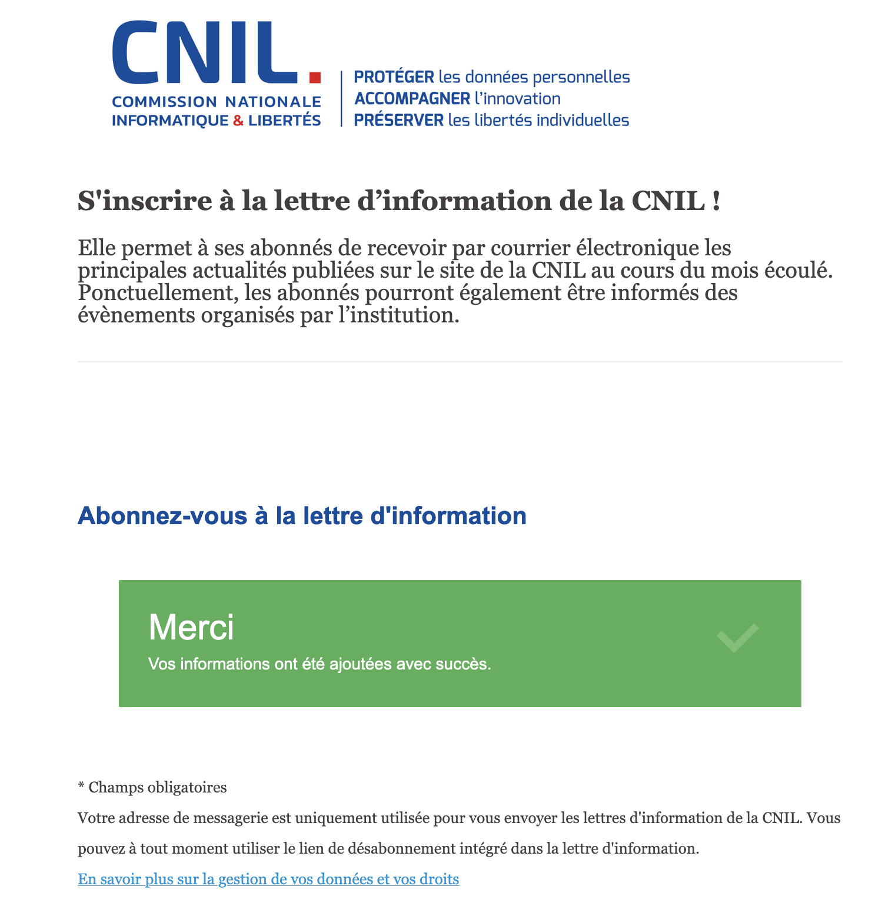

# Note de veille réglementaire — données du personnel de Hudson Cab Partners

Version du 6 novembre 2026. Cinq fiches, dispositif de suivi et confrontation de chaque règle du contrat. Les sources juridiques ont été consultées le 5 novembre 2026 ; champ territorial et référentiel RH CNIL revérifiés le 6 novembre 2026.

## 1. Le droit applicable

Le traitement : les données de chauffeurs employés à New York, gérées depuis Paris par Hudson Cab Europe, à qui le groupe a confié leur gestion.

| Question | Réponse | Source (texte et article) |
|---|---|---|
| Le RGPD s’applique-t-il à ce traitement ? | Oui : traitement automatisé de données personnelles dans le cadre des activités de Hudson Cab Europe, établie à Paris. | RGPD du 27 avril 2016, articles 2 §1 et 3 §1 — [CNIL](https://www.cnil.fr/fr/reglement-europeen-protection-donnees/chapitre1), consulté le 5 novembre 2026. |
| Pourquoi, alors que les chauffeurs ne sont pas en Europe ? | Le critère retenu est l’établissement européen ; la résidence américaine des chauffeurs ne l’écarte pas. La région d’hébergement ne suffit pas à elle seule à établir ce critère. | RGPD, article 3 §1 — même source. |
| Qui est responsable du traitement ? Qui est sous-traitant ? | Hudson Cab Europe : elle décide des finalités et moyens essentiels selon le brief. Snowflake est le prestataire de traitement pour le compte de cette entité ; sa qualification et les sous-traitants ultérieurs sont à documenter par les dispositions contractuelles applicables. Le rôle de l’entité new-yorkaise reste à préciser. | RGPD, articles 4 §7 et §8, et 28 — [définitions](https://www.cnil.fr/fr/reglement-europeen-protection-donnees/chapitre1), [obligations contractuelles](https://www.cnil.fr/fr/reglement-europeen-protection-donnees/chapitre4), consultés le 5 novembre 2026. |
| Quelle autorité de contrôle est compétente ? | La CNIL pour le traitement relevant de l’établissement français décrit dans le brief. Une éventuelle situation transfrontalière demanderait une analyse complémentaire. | RGPD, article 55 §1 — [CNIL](https://www.cnil.fr/fr/reglement-europeen-protection-donnees/chapitre6), consulté le 5 novembre 2026. |

## 2. Le dispositif de veille

**Outil en place : abonnement par courriel à la lettre officielle de la CNIL.** Inscription enregistrée le 6 novembre 2026, preuve ci-dessous. La première réception n’est pas encore consignée ; aucune adresse personnelle ni lien de confirmation n’est publié.

La lettre apporte les principales nouvelles mensuelles de la CNIL. Le dispositif associe cette notification automatique à une revue manuelle des trois sources officielles chaque vendredi, pendant vingt minutes. Cette fréquence est une règle d’organisation ; elle ne signifie pas qu’une revue hebdomadaire passée est déjà prouvée.

| Source officielle | Ce qu’on surveille | Fréquence de revue | Outil / état |
|---|---|---|---|
| [CNIL](https://www.cnil.fr/fr/actualite) | Recommandations RH, conservation, sécurité | Chaque vendredi, 20 minutes | [Lettre CNIL](https://www.cnil.fr/fr/newsletter) : inscription enregistrée ; preuve ci-dessus. Flux RSS facultatif en complément. |
| [CEPD / EDPB](https://www.edpb.europa.eu/news/news_en) | Interprétation territoriale, rôles, transferts et recommandations européennes | Même revue hebdomadaire | Consultation manuelle de la page officielle ; nouveautés et impacts consignés dans le journal de veille. |
| [EUR-Lex](https://eur-lex.europa.eu/legal-content/FR/TXT/?uri=CELEX:32016R0679) | Texte, rectificatifs et évolutions du RGPD | Même revue hebdomadaire, et avant changement majeur | Consultation manuelle du texte et de ses rectificatifs ; journal de veille. |
| [Documentation Snowflake](https://docs.snowflake.com/en/user-guide/data-availability) | Gouvernance, rétention, capacités techniques | Revue mensuelle et avant modification du pipeline | Revue documentaire manuelle ; complément aux trois sources réglementaires. |

L’équipe data centralise les nouveautés et consigne date, lien, impact, décision et action dans le journal ci-dessous. Une nouvelle recommandation reçue par la lettre déclenche une analyse ; les décisions juridiques sont soumises au conseil juridique ou au DPO, et les changements techniques passent par scripts et tests. Une alerte critique est traitée dès réception ; la fréquence hebdomadaire n’est pas une obligation légale.

## 3. Les fiches de veille

Sources consultées le **5 novembre 2026**. Les conséquences pour l’entrepôt sont notre analyse du scénario.

### Fiche 1 — Champ territorial et responsabilités

- **Source et date** : RGPD du 27 avril 2016, articles 3 §1 et 4 §7-8 ; [texte CNIL](https://www.cnil.fr/fr/reglement-europeen-protection-donnees/chapitre1). Complément : [CEPD, lignes directrices 3/2018, version finale du 12 novembre 2019](https://www.cnil.fr/sites/default/files/atoms/files/lignes_directrices_du_cepd_sur_le_champ_dapplication_territorial_du_rgpd.pdf).
- **Texte** : le cadre européen peut s’appliquer aux activités de l’établissement français malgré la résidence américaine des chauffeurs. Le décideur des finalités et moyens est responsable du traitement.
- **Entrepôt** : documenter Hudson Cab Europe et les prestataires ; distinguer établissement et région Snowflake.
- **Action** : qualification du responsable établie selon le brief ; prestations et contrats à vérifier.

### Fiche 2 — Minimisation, exactitude et conservation

- **Source et date** : RGPD du 27 avril 2016, article 5 §1 c-f et §2 ; [CNIL](https://www.cnil.fr/fr/reglement-europeen-protection-donnees/chapitre2).
- **Texte** : limiter les données et leur durée à l’usage justifié, maintenir leur exactitude et démontrer leur protection.
- **Entrepôt** : inventorier toutes les copies, justifier les cinq ans, tester les accès et purger sources et dérivations.
- **Action** : purge et inventaire implémentés ; la règle uniforme R1 reste à justifier juridiquement.

### Fiche 3 — Base active et archivage intermédiaire

- **Source et date** : CNIL, [Comment concilier les durées de conservation et les archives ?](https://www.cnil.fr/fr/comment-concilier-les-durees-de-conservation-et-les-archives), 18 septembre 2019. Page illustrant le cycle de vie pour les collectivités ; distinction utilisée ici avec le référentiel RH, sans transposer ses obligations sectorielles.
- **Texte** : après l’usage courant, certains éléments peuvent être archivés pour une obligation ou un contentieux, avec accès restreint et durée justifiée.
- **Entrepôt** : un chauffeur parti ne devrait pas rester accessible aux usages courants sans justification. Séparer logiquement ou physiquement l’archive et tracer ses consultations.
- **Action** : proposer cette évolution à la direction. Le brief ne prévoit pas cette séparation ; ne pas modifier silencieusement sa matrice.

### Fiche 4 — Actualisation de la veille RH en 2026

- **Source et date** : CNIL, [présentation du référentiel de durées RH](https://www.cnil.fr/fr/referentiel-durees-conservation-donnees-rh), 2 avril 2026 ; adopté par [délibération 2026-031 du 29 janvier 2026](https://www.legifrance.gouv.fr/jorf/id/JORFTEXT000053749693).
- **Texte** : le référentiel vise les personnels soumis au droit du travail français ; les fondements de chaque durée doivent correspondre au cas traité.
- **Entrepôt** : l’établissement parisien ne suffit pas à rendre toutes les durées françaises applicables aux contrats new-yorkais.
- **Action** : faire établir par le juriste les obligations applicables par catégorie. Le référentiel complète les ressources RH antérieures, il ne remplace pas cette analyse.

### Fiche 5 — Sécurité, registre et preuves

- **Source et date** : RGPD du 27 avril 2016, articles 25, 28, 30 et 32 ; [CNIL](https://www.cnil.fr/fr/reglement-europeen-protection-donnees/chapitre4).
- **Texte** : prévoir une protection adaptée, encadrer les prestataires et documenter le traitement. La sécurité doit être évaluée.
- **Entrepôt** : rôles, masquage, filtrage, cahier de tests et audit apportent des preuves techniques ; REGISTRE.md rassemble le traitement et ses limites.
- **Action** : construire les politiques après les tests attendus. Les contrats prestataires, l’information des personnes et l’exercice des droits restent à vérifier avec le DPO.

## 4. Le contrat face aux textes

Analyse documentaire avant implémentation. « Cohérent » signifie que le mécanisme va dans le sens du texte ; aucune conformité de l’entrepôt n’est attestée sans tests. Sources : **A** = fiche 2 ; **B** = fiche 3 ; **C** = fiche 4 ; **D** = fiche 5 ; **E** = article 4 §1, fiche 1.

| Exigence | Référence | Évaluation / écart | Proposition ou preuve attendue |
|---|---|---|---|
| R1 : supprimer cinq ans après le départ, toutes copies | A, B, C | Justification uniforme absente ; pas de distinction usage courant / archive. | Appliquer R1 pour l’exercice, signaler l’écart ; demander calendrier par finalité, accès aux archives et droit applicable. Purger aussi services et dérivations. |
| R2 : Time Travel au plus un jour | A, D | Limitation technique cohérente, pas effacement physique immédiat. | Paramètre sur chaque table concernée ; documenter Fail-safe et copies annexes. |
| R3 : vider le stage | A, D | Cohérent avec la réduction des copies. | Vérifier LIST vide après chargement ; les CSV locaux restent à gérer aussi. |
| RH_PAIE : tout en clair | A, D | Besoin à justifier par attribut ; un rôle ne prouve pas la nécessité. | Matrice du brief appliquée et testée ; minimisation à revoir avec RH. |
| Responsables : leur dépôt, noms et téléphone en clair | A, D | Cloisonnement cohérent ; anciens chauffeurs non distingués. | Mapping rôle/dépôt et tests négatifs ; proposer restriction de l’archive. |
| ANALYSTE : tous dépôts, identifiant et année de naissance | A, E | Réduit l’identification directe ; reste personnel, pas anonyme. | Masquer identité et coordonnées, contrôler driver_name ; justifier l’année de naissance. |
| GOUVERNANCE et ACCOUNTADMIN sans lecture métier | D | Séparation des fonctions cohérente, pas garantie absolue contre un administrateur qui change les règles. | Tester rôle principal, désactiver rôles secondaires ; auditer changements et accès. |
| TRANSFORMER lit et transforme | D | Accès nécessaire mais pouvoir étendu et risque de compromission. | Limiter utilisation, protéger authentification et tracer les actions. |
| Rôles, jamais droits métier par utilisateur nommé | D | Gestion des habilitations cohérente. | Attribuer des rôles ; vérifier privilèges et héritages. |
| Catalogue, descriptions, trois tags | D, E | Inventaire utile ; valeurs de tags insuffisantes pour toute l’activité personnelle. | Écart consigné ; valeurs imposées conservées et masques directs sur les catégories non couvertes. |
| Scripts rejouables et maintien des protections | D | Vérifiabilité cohérente. | Rejouer puis vérifier tags, commentaires et politiques ; éviter la recréation destructive des tables. |
| Pas de secrets ni données personnelles dans Git public | D | Cohérent. | Vérifier fichiers, historique et captures avant publication. |
| licence_unique, seuil zéro | A | Contrôle pertinent, résultat à mesurer. | Enregistrer doublons ; avertissement n’équivaut pas à correction. |
| telephone_renseigne, seuil 5 % des actifs | A | Seuil opérationnel, pas exemption juridique d’exactitude. | Mesurer et traiter les anomalies ; justifier la tolérance. |
| email_valide, seuil zéro | A | Présence de @ : contrôle limité. | Documenter qu’il ne prouve ni délivrabilité ni identité. |
| dates_coherentes, seuil zéro | A | Contrôle pertinent, non exhaustif. | Tester dates puis organiser correction des anomalies. |
| depot_connu, seuil zéro | A | Référentiel utile, résultat à mesurer. | Vérifier valeurs RAW sans dissimuler les erreurs par nettoyage. |
| service_rattache, seuil 50, bloquant | A | Tolérance contractuelle, pas garantie générale d’exactitude. | Enregistrer résultat puis arrêter avant reconstruction au dépassement ; tester le blocage. |
| service_unique, seuil zéro | A | Contrôle pertinent même si STAGING dédoublonne. | Mesurer dans RAW et enregistrer les doublons. |
| duree_plausible, seuil 16 heures | A | Plausibilité métier, pas preuve d’exactitude. | Documenter et examiner les anomalies. |

### Limite technique de R2 : Fail-safe

Pour les tables permanentes, Snowflake conserve une période Fail-safe de sept jours après Time Travel. Elle n’est pas configurable et n’est pas une extension de consultation normale par les rôles métier. Un jour de Time Travel suivi de sept jours de Fail-safe donne une succession nominale de huit jours : ce n’est pas une attestation d’effacement physique à heure fixe, notamment en présence de requêtes longues ou d’autres copies.

Source technique : [Snowflake, Understanding and viewing Fail-safe](https://docs.snowflake.com/en/en/user-guide/data-failsafe), documentation évolutive, consultée le 5 novembre 2026. Configuration à un jour prouvée sur quatre tables par la capture 11 ; lecture historique après purge prouvée par la capture 12.

## 5. Ce que la veille ne tranche pas

À soumettre au DPO ou conseil juridique de Hudson Cab Europe :

- Fondement du traitement par usage ; justification des données transmises et information des chauffeurs.
- Durées applicables aux contrats et obligations new-yorkais ; calendrier par catégorie et éventuels gels pour contentieux. Ne pas appliquer automatiquement les cinq ans du registre unique du personnel français à tous les fichiers américains.
- Rôle réel de Hudson Cab Partners et contrats de sous-traitance, prestataires ultérieurs et accès depuis des pays tiers. La région Paris ne prouve pas à elle seule l’absence de transfert international.
- Organisation de l’archive intermédiaire, habilitations et modalités d’exercice des droits.
- Extension de classification explicite D01 ; arbitrages juridiques distincts du choix technique, sans validation juridique fictive.

## 6. Journal et preuves de veille

| Date | Source / fait | Impact | Décision et action |
|---|---|---|---|
| 5 novembre 2026 | RGPD, articles 3 et 4 | Établissement décideur en France ; données de chauffeurs américains | Documenter Hudson Cab Europe responsable du traitement |
| 5 novembre 2026 | Référentiel RH CNIL, publié le 2 avril 2026 | Durées par activité, périmètre du droit du travail français | Ne pas transposer automatiquement aux contrats new-yorkais ; demander une justification par finalité |
| 6 novembre 2026 | Inscription à la lettre CNIL | Notification automatique des actualités | Abonnement enregistré, capture 01 |
| 6 novembre 2026 | Contrat et inventaire | Valeurs de tags insuffisantes | Écart identifié ; extension explicite D01 retenue, deux catégories et test de couverture |

Les propositions juridiques et décisions de conservation au-delà de l’exercice ne sont pas approuvées par un conseil dans le scénario. L’abonnement en place ne vaut pas souscription automatique aux autres organismes.

## Décision sur l’écart de taxonomie — 6 novembre 2026

Les six catégories initiales du contrat ne permettent pas de décrire fidèlement les vingt attributs professionnels et d’activité pourtant personnels. La classification complète exigée par C20 motive une extension explicite : donnee_professionnelle et activite. Les trois tags et les catégories initiales sont conservés ; les nouvelles valeurs ne changent pas la qualification juridique des données ni la matrice métier.

Cette décision diffère de la liste de valeurs initiale de la section 3 ; elle est justifiée dans DECISIONS.md et présentée comme une décision de conception du projet, sans prétendre à une validation du formateur ou du conseil juridique. Le contrat de référence reste inchangé. Le RGPD impose une protection et une documentation adaptées, pas ces noms précis de catégories Snowflake.

L’export initial 09 et la capture 02 restent des preuves historiques de la couverture partielle. La migration vise 39 colonnes personnelles taguées sur RAW/MARTS et zéro écart dans V_CATALOGUE. Les masques directs permettent de taguer DEPOT sans lui appliquer un masque incompatible avec sa fonction de clé de filtrage. Les tests 12 puis 10 doivent encore prouver la couverture et la stabilité des accès après cette évolution.
